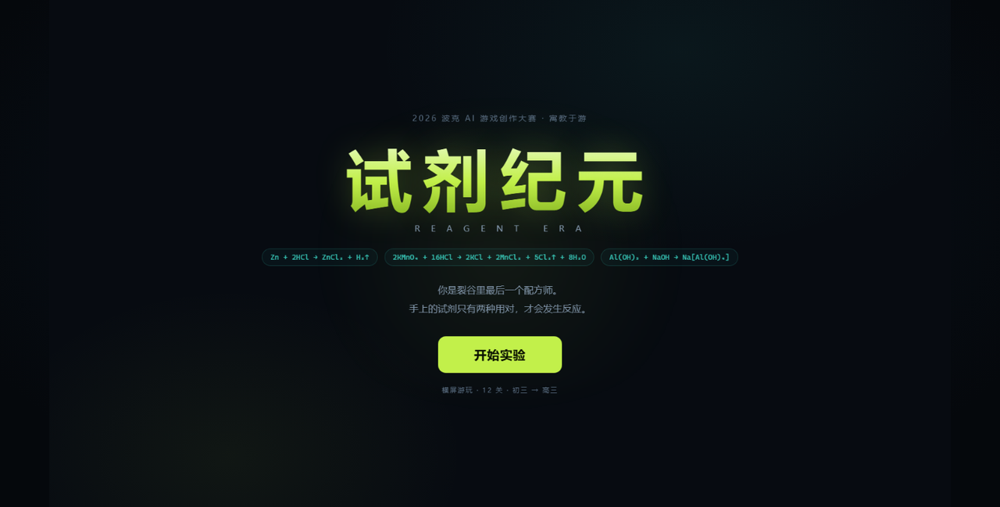
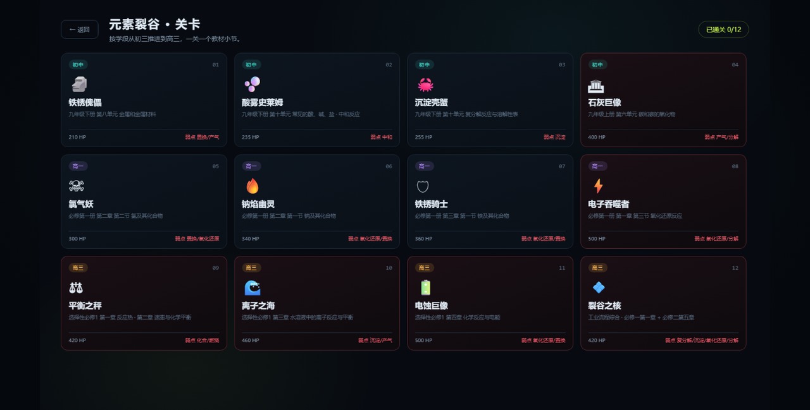
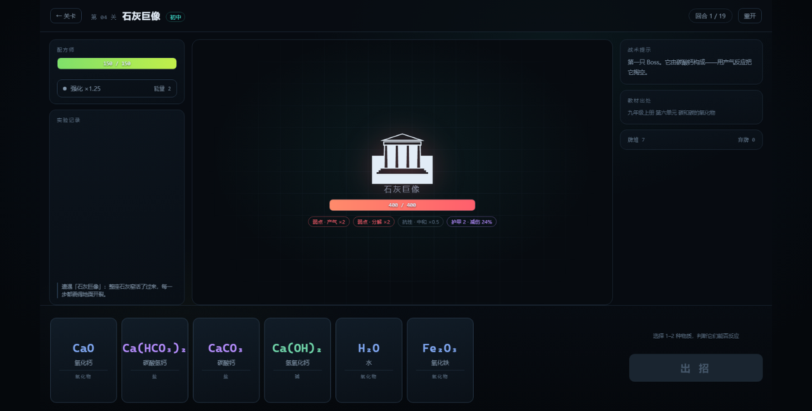

# 试剂纪元 · Reagent Era

[](https://github.com/ShanFuM/reagent-era/actions/workflows/ci.yml)

> 用化学反应对战。选两种试剂，判断它们能不能反应，配平，然后看它炸开。

> ⚠️ **本仓库为参赛作品，保留所有权利。未经许可请勿搬运、复制、商用或用于其他比赛。**
> 详见 [NOTICE.md](NOTICE.md)。

《试剂纪元》是一款回合制化学对战游戏：你手上是一把随机发放的化学物质，
敌人有明确的元素属性弱点。**选对反应 → 命中弱点 → 配平换伤害**。

- 参赛：2026 波克 AI 游戏创作大赛 · 寓教于游赛道
- 形态：纯前端网页，横屏 16:9，无后端
- 内容：28 关（四条年级线各 12 关），97 条手写方程式、96 种物质

<table>
  <tr>
    <td></td>
    <td></td>
  </tr>
  <tr>
    <td align="center"><sub>标题</sub></td>
    <td align="center"><sub>关卡选择</sub></td>
  </tr>
  <tr>
    <td colspan="2"></td>
  </tr>
  <tr>
    <td colspan="2" align="center"><sub>战斗界面：选两种试剂出招，弱点 ×2，护甲减伤 24%</sub></td>
  </tr>
</table>

---

## 快速开始

```bash
# 依赖（本机 pnpm 符号链接被系统限制，已用 .npmrc 改成扁平 node_modules）
pnpm install

pnpm dev          # 开发服务器 http://localhost:5173
pnpm build        # 生产构建 → dist/
pnpm build:single # 单文件离线包 → dist-single/index.html（双击即玩）
pnpm validate     # 化学数据校验（原子守恒 / 电荷守恒 / 最简整数比 / 关卡可解性）
pnpm test         # 化学式解析单元测试
```

> Node 版本用 DSH 自带运行时：
> `C:\Users\张峻搏\.dsh\dsh-runtimes\dsh-primary-runtime\dependencies\node\bin\node.exe`
> 构建需要启动编译子进程，在当前沙箱下需以完全权限执行一次。

## 目录结构

```
data/            游戏内容（纯 JSON，两个人可以同时改不冲突）
  substances.json  物质表：id / 中文名 / 化学式 / 类别
  reactions.json   反应表：反应物 / 生成物 / 类型 / 条件 / 现象 / 教材出处
  levels.json      关卡表：敌人 / 试剂架 / 手牌 / 能量 / 配平时限
src/engine/      纯逻辑，不碰 DOM，可被无头脚本直接调用
  formula.js       化学式解析与配平判定（JS + JSDoc，Node 与浏览器共用）
  chem.ts          反应规则引擎：离子表、溶解性表、7 条反应规则、通用配平器
  data.ts          加载 JSON、手写反应表优先、规则引擎兜底
  battle.ts        战斗状态机：出招 / 判定 / 伤害 / 敌方回合 / 胜负
src/ui/          界面
scripts/         validate-data.mjs（数据校验）、chem-check.ts（反应判定回归）、
                 sim.ts（无头对战模拟）、formula.test.mjs
docs/GDD.md      玩法与数值设计文档
AGENTS.md        给「两个人的 AI」看的项目宪法
```

## 怎么加内容

**加一条方程式**：在 `data/reactions.json` 里按现有格式加一条，
然后 `pnpm validate`。校验器会拒绝：原子不守恒、电荷不守恒、系数没有化成最简整数比、
同一组反应物对应两个不同产物（会让玩家无法判断）。

**加一个物质**：`data/substances.json`，`id` 必须就是化学式本身（如 `Na[Al(OH)4]`）。

**改关卡**：`data/levels.json`。`shelf` 是这一关的试剂架，
校验器会检查「至少 3 条可打出的反应」和「至少 1 条能命中弱点」。

## 部署

三种产物都来自同一份代码：

| 目标 | 命令 | 产物 |
|---|---|---|
| 网页（主） | `pnpm build` | `dist/`，静态托管即可 |
| 离线单文件 | `pnpm build:single` | `dist-single/index.html`，双击即玩 |
| 桌面 exe | 暂不做 | — |

静态托管选型（国内访问 + 备案成本已在 `docs/GDD.md` 讨论过）：

- **Cloudflare Pages**：连 GitHub，push 自动部署，自带 HTTPS，5 分钟上线；国内访问一般
- **阿里云 OSS 香港节点 + 自有域名**：无需备案，国内速度更好，约 10 元/月
- **阿里云大陆节点**：必须 ICP 备案，2–4 周，赶不上 12-01

## 现状

- [x] 28 关全部可玩，97 条手写方程式，96 种物质
- [x] **四条年级线**：初三 / 高一 / 高二 / 高三各 12 关，前 4 关共用（新手教程）
- [x] **反应规则引擎**：任意两种物质都能按化学规律判定，不再依赖查表
- [x] 配平系统（8–15 秒倒计时，完美配平加成）
- [x] 弱点 / 抗性 / 护甲 / 灼烧 / 窒息 / 护盾 / 腐蚀
- [x] 化学数据自动校验 + 无头对战模拟
- [x] 第 12 关三阶段 Boss（工业流程 / 推断链 / 综合）
- [x] 难度门槛：7–12 关必须有一次完美配平或强化才能收尾
- [x] 每关「通关提示」：按数据推导标准答案，不额外维护清单
- [x] 角色与特效：SVG 敌人 / 玩家形象、出招飞行与冲击波、发牌动画、血条刻度
- [ ] 离子方程式模式（高一学段）
- [ ] 音效与打击反馈
- [ ] 存档导出 / 排行榜
- [x] 教学设计文档（赛道强制项）→ [docs/教学设计.md](docs/教学设计.md)
